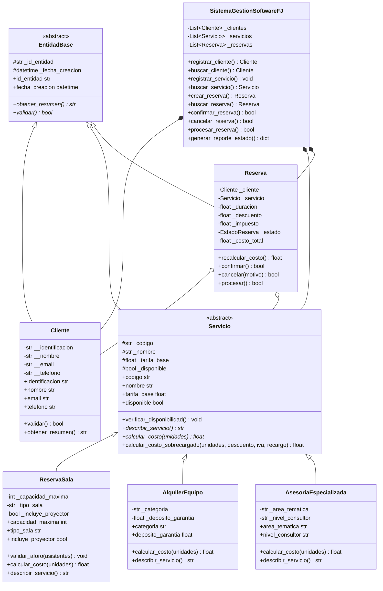

# Software FJ - Sistema Integral de Gestión de Clientes, Servicios y Reservas


Proyecto desarrollado para la **Universidad Nacional Abierta y a Distancia (UNAD)** en el curso **Programación (Código 213023) - Fase 4: Prácticas Simuladas**.

Desarrollado y presentado por: **Juana Valentina** (Usuario GitHub: `JuanJoseVargasRamos`).

---

## 📋 Resumen del Proyecto

**Software FJ** es una plataforma orientada a objetos (POO) diseñada para gestionar clientes, servicios especializados y reservas en memoria sin utilizar bases de datos relacionales ni motores SQL.

La solución cumple rigurosamente con los 4 criterios de la rúbrica oficial (150 puntos):
- **Abstracción, Encapsulación, Herencia y Polimorfismo** con clases abstractas y métodos sobrecargados.
- **Jerarquía completa de 17 Excepciones Personalizadas** derivadas de `SoftwareFJException` con códigos de error (incluye `ReservaNoEncontradaException`).
- **Estructuras de control:** `try/except`, `try/except/else`, `try/finally` y **encadenamiento de excepciones** (`raise ... from error_original`).
- **Validación rigurosa de números finitos:** Blindaje contra inyecciones `float('nan')` o `float('inf')` mediante `math.isfinite()`.
- **Sistema centralizado de Logging:** Con rotación automática de archivos (`RotatingFileHandler` a 1 MB y 3 respaldos) en `logs/software_fj.log` y `logs/software_fj_ejemplo.log`.
- **Suite de 16 simulaciones automáticas oficiales** con aserciones estrictas (`esperar_excepcion`), previniendo falsos positivos y garantizando que el sistema **nunca se interrumpe ni colapsa**.
- **Gestión profesional en GitHub:** Implementada mediante Git Flow separando responsabilidades en ramas temáticas (`feature/*`), Pull Requests fusionados (**PR #6, PR #7, PR #8 y PR #9**) e **Issues #1 al #5** asignados y cerrados.

---

## 🏛️ Arquitectura del Sistema

```
software_fj/
│
├── configuracion/
│   ├── __init__.py
│   └── logger_config.py          # Logging con RotatingFileHandler (1MB, 3 backups) y salida dual
│
├── excepciones/
│   ├── __init__.py
│   └── excepciones_sistema.py    # Jerarquía completa de 17 excepciones personalizadas
│
├── modelos/
│   ├── __init__.py
│   ├── base.py                   # Clase abstracta EntidadBase
│   ├── cliente.py                # Clase Cliente (encapsulación estricta y regex de nombre/correo)
│   ├── servicio.py               # Servicio (abstracta) y 3 clases derivadas polimórficas
│   └── reserva.py                # Clase Reserva con estados y bloques try/except/else/finally
│
├── servicios/
│   ├── __init__.py
│   └── gestor_sistema.py         # Controlador en memoria con listas internas y buscar_reserva
│
├── logs/
│   ├── software_fj.log           # Archivo de auditoría y eventos en vivo
│   └── software_fj_ejemplo.log   # Muestra persistente de auditoría de simulaciones
│
├── documentacion/
│   └── Fase_4_Juana_Software_FJ_Actualizado.docx # Documento formal de entrega
│
├── simulaciones.py               # Batería oficial de 16 simulaciones con aserciones estrictas (esperar_excepcion)
├── main.py                       # Interfaz de consola interactiva blindada contra EOFError
├── README.md                     # Documentación completa y guía de GitHub
└── .gitignore
```

---

## 🧬 Diagrama de Clases (POO)



---

## ⚠️ Jerarquía de 17 Excepciones Personalizadas

```mermaid
graph TD
    A[Exception (Python)] --> B[SoftwareFJException]
    B --> C[DatosInvalidosException]
    C --> C1[IdentificacionInvalidaException]
    C --> C2[EmailInvalidoException]
    C --> C3[TelefonoInvalidoException]

    B --> D[ServicioException]
    D --> D1[ServicioNoDisponibleException]
    D --> D2[ParametroServicioInvalidoException]
    D --> D3[CapacidadExcedidaException]

    B --> E[ReservaException]
    E --> E1[ReservaInvalidaException]
    E --> E2[ReservaNoEncontradaException]
    E --> E3[EstadoReservaInvalidoException]
    E --> E4[ClienteNoEncontradoException]
    E --> E5[ServicioNoEncontradoException]

    B --> F[OperacionNoPermitidaException]
    B --> G[CalculoInconsistenteException]
```

---

## 👥 Trazabilidad y Trabajo Colaborativo en GitHub (5 Roles Simulados)

Conforme a las orientaciones de la Fase 4 y para evidenciar el cumplimiento del **Criterio 4 (30 puntos)** en modalidad de entrega independiente, el repositorio aplicó **Git Flow** separando las responsabilidades técnicas en ramas independientes, Pull Requests fusionados e Issues:

| Rol Técnico Simulado | Rama Asignada (`Branch`) | Responsabilidad Técnica | Issue Asociado | Pull Request Fusionado |
|---|---|---|:---:|:---:|
| **Juana Valentina (Líder / Arquitectura)** | `main` | Configuración de logs rotativos, clase abstracta `EntidadBase` y consolidación | **Issue #1** | Rama principal consolidada |
| **Rol 2: Especialista en Validación** | `feature/excepciones-personalizadas` | Jerarquía completa de 17 excepciones derivadas de `SoftwareFJException` | **Issue #2** | **[PR #9 (Merged)](https://github.com/JuanJoseVargasRamos/software-fj-fase4/pull/9)** |
| **Rol 3: Modelado de Dominio** | `feature/modulo-clientes` | Clase `Cliente`, encapsulación estricta y validación regex | **Issue #3** | **[PR #6 (Merged)](https://github.com/JuanJoseVargasRamos/software-fj-fase4/pull/6)** |
| **Rol 4: Servicios y Polimorfismo** | `feature/servicios-polimorfismo` | Subclases `ReservaSala`, `AlquilerEquipo`, `AsesoriaEspecializada` | **Issue #4** | **[PR #7 (Merged)](https://github.com/JuanJoseVargasRamos/software-fj-fase4/pull/7)** |
| **Rol 5: Reservas y Control de Calidad** | `feature/reservas-simulaciones` | Ciclo de vida de `Reserva` (`try/else/finally`) y suite de 14 simulaciones | **Issue #5** | **[PR #8 (Merged)](https://github.com/JuanJoseVargasRamos/software-fj-fase4/pull/8)** |

---

## 🧪 Batería de 16 Simulaciones Oficiales Implementadas

El script `simulaciones.py` ejecuta automáticamente los siguientes 16 casos de prueba mediante un runner modular con aserciones estrictas (`esperar_excepcion`), asegurando que las excepciones se disparen efectivamente y descartando cualquier falso positivo:

| # | Tipo | Escenario Evaluado | Excepción Gestionada | Mecanismo Demostrado |
|---|------|---------------------|-----------------------|----------------------|
| **1** | Válida | Registro exitoso de clientes | Ninguna (Flujo nominal) | Encapsulación / Getters / Setters |
| **2** | Inválida | Registro con Email sin `@` o dominio | `EmailInvalidoException` | Validación Regex estándar simplificada |
| **3** | Inválida | Registro con Teléfono alfabético | `TelefonoInvalidoException` | Control de formato numérico |
| **4** | Inválida | Intento de registro con cédula duplicada | `OperacionNoPermitidaException` | Verificación de unicidad en listas |
| **5** | Válida | Alta del catálogo con los 3 servicios | Ninguna | Polimorfismo y clases derivadas |
| **6** | Inválida | Creación de servicio con capacidad negativa | `ParametroServicioInvalidoException` | Validación de parámetros de constructor |
| **7** | Válida | Ciclo completo: Creación -> Confirmación -> Facturación | Ninguna | `try/except/else` y `try/finally` |
| **8** | Inválida | Reserva de un servicio inactivo o en mantenimiento | `ServicioNoDisponibleException` | Validación de disponibilidad previa |
| **9** | Inválida | Creación de reserva con cédula inexistente | `ClienteNoEncontradoException` | Búsqueda relacional en colecciones |
| **10** | Inválida | Aforo superado en sala (45 personas para cupo de 12) | `CapacidadExcedidaException` | Reglas de negocio en subclases |
| **11** | Inválida | Cancelación ilegal de una reserva ya procesada | `EstadoReservaInvalidoException` | Transición de estados finitos |
| **12** | Válida | Cancelación exitosa evidenciando el bloque `else` | Ninguna | **Mutación estricta de estado en bloque `else`** |
| **13** | Inválida | Transición ilegal: procesar reserva en estado PENDIENTE | `EstadoReservaInvalidoException` | Transición de estados finitos |
| **14** | Inválida | Cálculo sobrecargado con descuento mayor al 80% | `CalculoInconsistenteException` | **Encadenamiento de excepciones (`raise ... from`)** |
| **15** | Inválida | Búsqueda relacional de reserva inexistente | `ReservaNoEncontradaException` | Búsqueda y control en colecciones |
| **16** | Inválida | Blindaje matemático contra valor `float('nan')` | `CalculoInconsistenteException` | **Validación estricta con `math.isfinite` y encadenamiento** |

---

## 🚀 Instrucciones de Ejecución

### 1. Ejecutar la Batería Oficial de Simulaciones
```bash
python simulaciones.py
```

### 2. Ejecutar el Menú Interactivo del Sistema
```bash
python main.py
```

---

## 📄 Licencia y Créditos Académicos
Desarrollado bajo fines exclusivamente académicos para la **Universidad Nacional Abierta y a Distancia (UNAD)**.  
Curso: Programación (Código 213023). Noviembre de 2026.
