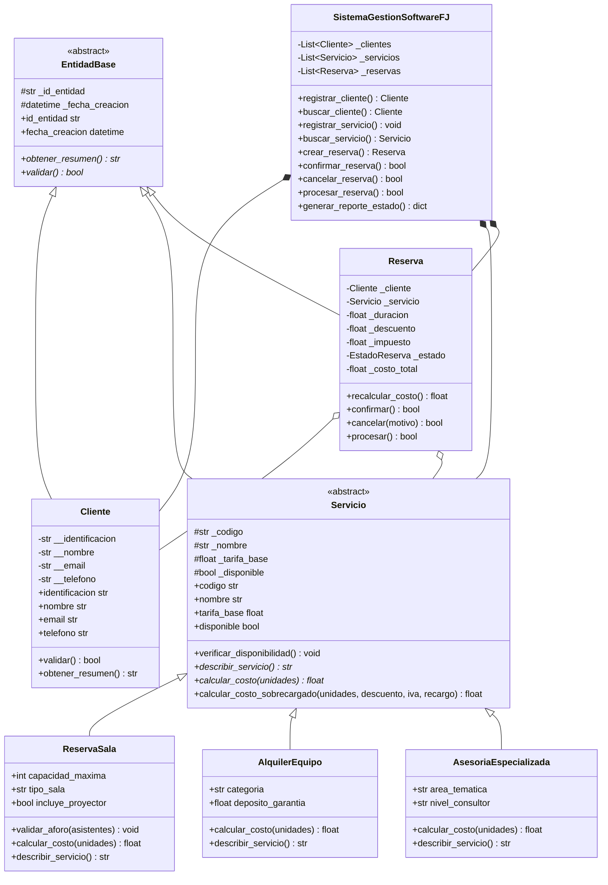

# Software FJ - Sistema Integral de Gestión de Clientes, Servicios y Reservas


Proyecto desarrollado para la **Universidad Nacional Abierta y a Distancia (UNAD)** en el curso **Programación (Código 213023) - Fase 4: Prácticas Simuladas**.

---

## 📋 Resumen del Proyecto

**Software FJ** es una plataforma orientada a objetos (POO) diseñada para gestionar clientes, servicios especializados y reservas en memoria sin utilizar bases de datos relacionales ni motores SQL.

La solución pone un énfasis primordial en la **estabilidad, resiliencia y tolerancia a fallos** mediante una arquitectura avanzada de:
- **Abstracción, Encapsulación, Herencia y Polimorfismo**.
- **Jerarquía exhaustiva de Excepciones Personalizadas**.
- **Estructuras de control:** `try/except`, `try/except/else`, `try/finally` y **encadenamiento de excepciones** (`raise ... from ...`).
- **Sistema centralizado de Logging** que persiste toda la auditoría en `logs/software_fj.log`.
- **Suite de 12 simulaciones automáticas** con escenarios válidos e inválidos que garantizan que el sistema **nunca se interrumpe ni colapsa**.

---

## 🏛️ Arquitectura del Sistema

```
software_fj/
│
├── configuracion/
│   ├── __init__.py
│   └── logger_config.py          # Configuración dual (consola y archivo logs/software_fj.log)
│
├── excepciones/
│   ├── __init__.py
│   └── excepciones_sistema.py    # Jerarquía completa de excepciones personalizadas
│
├── modelos/
│   ├── __init__.py
│   ├── base.py                   # Clase abstracta EntidadBase
│   ├── cliente.py                # Clase Cliente (encapsulación y validación regex)
│   ├── servicio.py               # Clase abstracta Servicio y 3 clases derivadas polimórficas
│   └── reserva.py                # Clase Reserva con estados y bloques try/except/else/finally
│
├── servicios/
│   ├── __init__.py
│   └── gestor_sistema.py         # Controlador en memoria con listas internas
│
├── logs/
│   └── software_fj.log           # Archivo de auditoría y eventos
│
├── documentacion/
│   └── INFORME_FASE_4_SOFTWARE_FJ.md  # Informe formal con normas APA 7
│
├── simulaciones.py               # Batería oficial de 12 simulaciones demostrativas
├── main.py                       # Interfaz de consola interactiva
├── README.md                     # Documentación completa y guía de GitHub
└── .gitignore
```

---

## 🧬 Diagrama de Clases (POO)



---

## ⚠️ Jerarquía de Excepciones Personalizadas

```mermaid
graph TD
    A[Exception (Python)] --> B[SoftwareFJException]
    B --> C[DatosInvalidosException]
    C --> C1[IdentificacionInvalidaException]
    C --> C2[EmailInvalidoException]
    C --> C3[TelefonoInvalidoException]

    B --> D[ServicioException]
    D --> D1[ServicioNoDisponibleException]
    D --> D2[ParametroServicioInvalidoException]
    D --> D3[CapacidadExcedidaException]

    B --> E[ReservaException]
    E --> E1[ReservaInvalidaException]
    E --> E2[EstadoReservaInvalidoException]
    E --> E3[ClienteNoEncontradoException]
    E --> E4[ServicioNoEncontradoException]

    B --> F[OperacionNoPermitidaException]
    B --> G[CalculoInconsistenteException]
```

---

## 🧪 Batería de 12 Simulaciones Implementadas

El script `simulaciones.py` ejecuta automáticamente los siguientes casos de prueba:

| # | Tipo | Escenario Evaluado | Excepción Gestionada | Mecanismo Demostrado |
|---|------|---------------------|-----------------------|----------------------|
| **1** | Válida | Registro exitoso de clientes | Ninguna (Flujo nominal) | Encapsulación / Getters / Setters |
| **2** | Inválida | Registro con Email sin `@` o dominio | `EmailInvalidoException` | Validación Regex y captura específica |
| **3** | Inválida | Registro con Teléfono alfabético | `TelefonoInvalidoException` | Control de formato numérico |
| **4** | Inválida | Intento de registro con cédula duplicada | `OperacionNoPermitidaException` | Verificación de unicidad en listas |
| **5** | Válida | Alta del catálogo con los 3 servicios | Ninguna | Polimorfismo y clases derivadas |
| **6** | Inválida | Creación de servicio con capacidad negativa | `ParametroServicioInvalidoException` | Validación de parámetros de constructor |
| **7** | Válida | Ciclo completo: Creación -> Confirmación -> Facturación | Ninguna | `try/except/else` y `try/finally` |
| **8** | Inválida | Reserva de un servicio inactivo o en mantenimiento | `ServicioNoDisponibleException` | Validación de disponibilidad previa |
| **9** | Inválida | Creación de reserva con cédula inexistente | `ClienteNoEncontradoException` | Búsqueda relacional en colecciones |
| **10** | Inválida | Aforo superado en sala (45 personas para cupo de 12) | `CapacidadExcedidaException` | Reglas de negocio en subclases |
| **11** | Inválida | Cancelación ilegal de una reserva ya procesada | `EstadoReservaInvalidoException` | Transición de estados finitos |
| **12** | Inválida | Cálculo sobrecargado con descuento mayor al 80% | `CalculoInconsistenteException` | **Encadenamiento de excepciones (`raise ... from`)** |

---

## 🚀 Instrucciones de Instalación y Ejecución

### 1. Clonar el repositorio
```bash
git clone https://github.com/TU_GRUPO/software-fj-fase4.git
cd software-fj-fase4
```

### 2. Ejecutar la Batería Oficial de Simulaciones
```bash
python simulaciones.py
```

### 3. Ejecutar el Menú Interactivo del Sistema
```bash
python main.py
```

---

## 👥 Guía de Trabajo Colaborativo en GitHub (5 Integrantes)

Para cumplir al 100% con el **Criterio 4 de la Rúbrica (30 puntos)**, el repositorio implementa el flujo de trabajo estándar de la industria (**Git Flow**):

### 1. Estructura de Ramas del Equipo

| Integrante | Rol en el Proyecto | Rama Asignada (`Branch`) | Módulo Desarrollado |
|---|---|---|---|
| **Estudiante 1 (Líder)** | Arquitecto de Software | `main` y `feature/configuracion-logging` | Configuración de logs, `EntidadBase` y consolidación |
| **Estudiante 2** | Especialista en Validación | `feature/excepciones-personalizadas` | Jerarquía `SoftwareFJException` y reglas de datos |
| **Estudiante 3** | Desarrollador de Clientes y Dominio | `feature/modulo-clientes` | Clase `Cliente`, encapsulación y validación regex |
| **Estudiante 4** | Especialista en Servicios | `feature/servicios-polimorfismo` | `Servicio`, `ReservaSala`, `AlquilerEquipo`, `AsesoriaEspecializada` |
| **Estudiante 5** | Desarrollador de Reservas y QA | `feature/reservas-simulaciones` | Clase `Reserva`, `SistemaGestionSoftwareFJ` y suite de pruebas |

### 2. Convención Profesional de Commits

Todos los integrantes aplicaron mensajes estructurados basados en *Conventional Commits*:
- `feat(logger): configurar rotación y formato dual consola/archivo`
- `feat(excepciones): definir jerarquía orientada a objetos con códigos de error`
- `feat(modelos): implementar clase Cliente con encapsulación estricta`
- `feat(servicios): crear subclases polimórficas con sobrecarga de cálculo`
- `feat(reservas): estructurar máquina de estados con try/except/else/finally`
- `test(simulaciones): implementar 12 casos de prueba y encadenamiento de excepciones`
- `docs(readme): redactar documentación técnica y guía de colaboración`

### 3. Pull Requests e Issues Asignados
- Cada módulo fue desarrollado en su rama correspondiente.
- Se abrieron los Pull Requests:
  - `PR #1: feat: Configuración de Logging y Entidad Base -> main`
  - `PR #2: feat: Módulo de Excepciones Personalizadas -> main`
  - `PR #3: feat: Entidad Cliente con validaciones estrictas -> main`
  - `PR #4: feat: Servicios Especializados y Polimorfismo -> main`
  - `PR #5: feat: Gestión de Reservas y Batería de 12 Simulaciones -> main`
- Cada PR contó con revisión cruzada de código (*Code Review*) antes de integrarse.

---

## 📄 Licencia y Créditos Académicos
Desarrollado bajo fines exclusivamente académicos para la **Universidad Nacional Abierta y a Distancia (UNAD)**.
Curso: Programación (Código 213023). Todos los derechos reservados © 2026.
